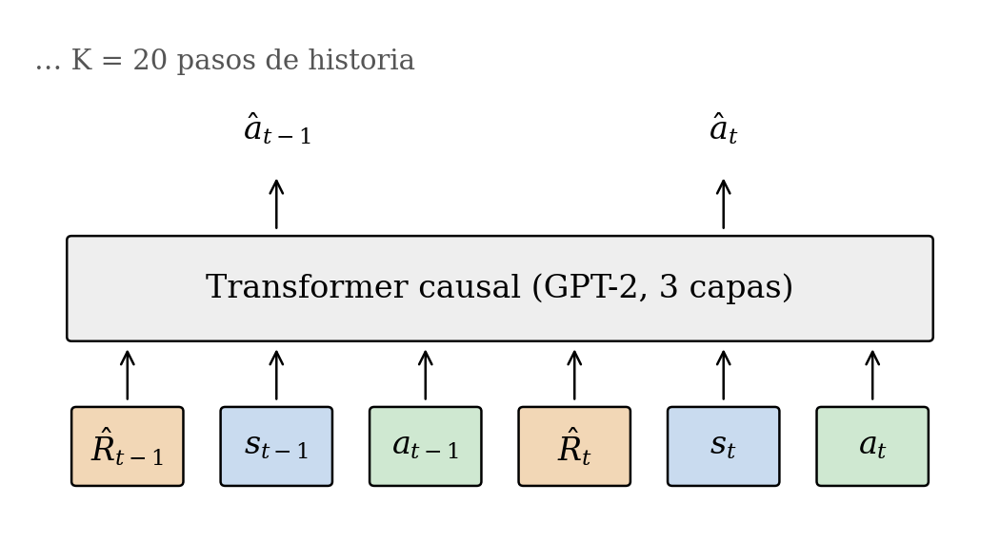
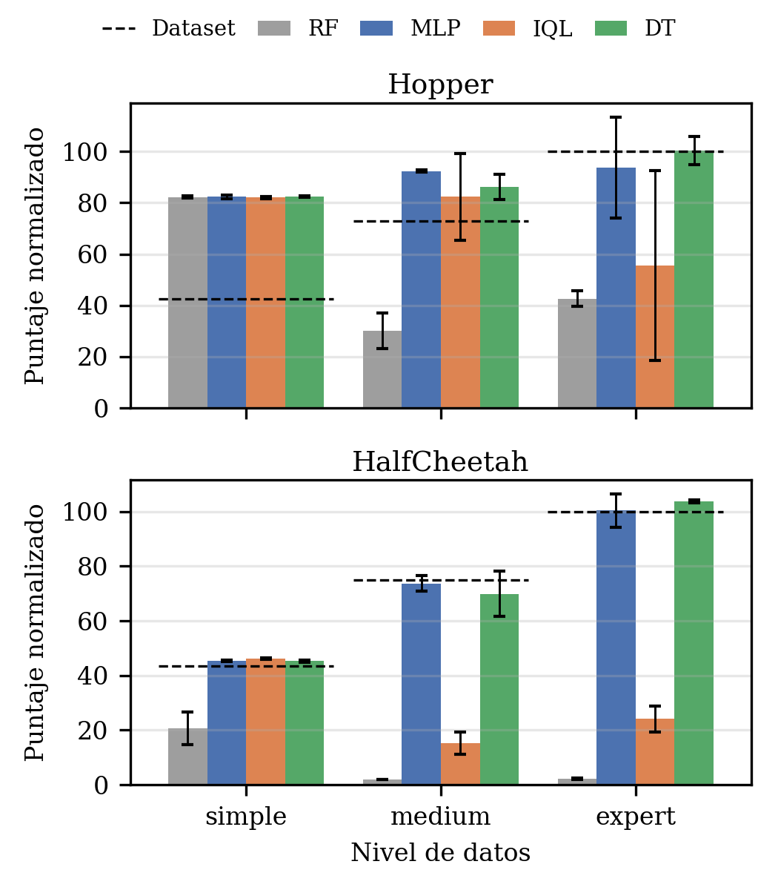
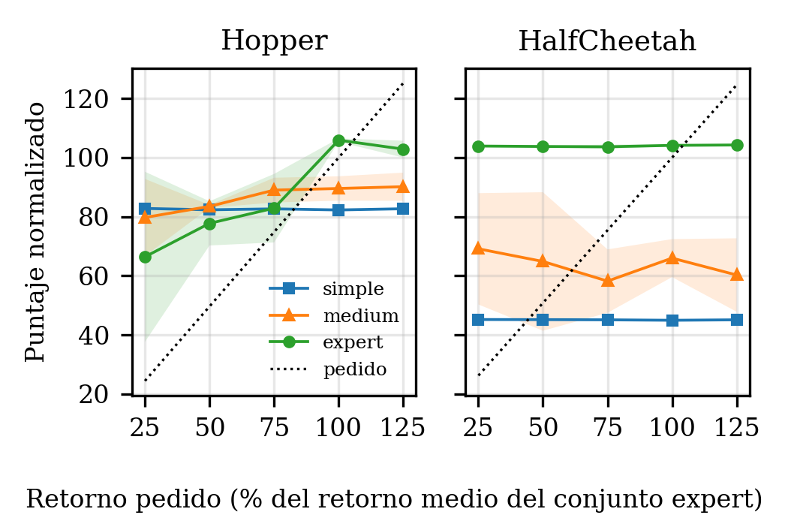

# Control robótico a partir de datos registrados: Decision Transformer frente a métodos clásicos

Proyecto final de **Aprendizaje Profundo** (periodo 2026-30), Maestría en Inteligencia Artificial,
Pontificia Universidad Javeriana.
**Autor:** Daniel Sebastian Velasco Munar · **Profesor:** Andrés Darío Moreno Barbosa

---

## El problema

En robótica, conducción autónoma o control industrial no es viable que un agente aprenda por ensayo y error,
porque cada fallo puede dañar equipos o personas. Lo que sí suele existir son **registros de operación** de
controladores anteriores. El aprendizaje por refuerzo fuera de línea busca aprender una política de control
**solo a partir de esos registros**, sin interactuar con el entorno durante el entrenamiento.

El **Decision Transformer** (Chen *et al.*, 2021) replantea el problema como modelado de secuencias: un
Transformer causal recibe la historia de estados, acciones y el retorno que se desea obtener, y predice la
siguiente acción.

> **Pregunta:** ¿puede un Transformer que modela el control como una secuencia igualar o superar a un método
> basado en la función Q y a la imitación directa, cuando aprende solo de datos registrados de calidad variable?

<p align="center">
  
</p>

## Modelos comparados

| Modelo | Tipo | Implementación |
|---|---|---|
| Clonación de comportamiento con **Random Forest** | Aprendizaje de máquina tradicional | scikit-learn, 100 árboles |
| Clonación de comportamiento con **MLP** | Red neuronal simple (2 × 256) | PyTorch |
| **Implicit Q-Learning (IQL)** | RL fuera de línea con función Q | d3rlpy |
| **Decision Transformer (DT)** | Transformer causal tipo GPT-2 (3 capas, contexto de 20 pasos) | Hugging Face Transformers |

## Datos

Conjuntos públicos de [Minari](https://minari.farama.org) (sucesor de D4RL) para dos robots del simulador
**MuJoCo**, cada uno con tres niveles de calidad (`simple`, `medium`, `expert`) y cerca de un millón de pasos:

| Robot | Descripción | Estado | Acción |
|---|---|---|---|
| **Hopper** | Robot de una pierna que debe saltar hacia adelante sin caerse | 11 variables | 3 motores |
| **HalfCheetah** | Guepardo en dos dimensiones que debe correr lo más rápido posible | 17 variables | 6 motores |

Los datos se descargan solos con la librería `minari`, que además recupera el simulador exacto para evaluar.

## Protocolo

- 90 % de los episodios para entrenar y 10 % para medir el error de predicción de acciones (MSE de validación).
- MLP, IQL y DT: **100 000 pasos** de entrenamiento. Random Forest: 100 000 transiciones.
- **3 semillas** × 2 robots × 3 conjuntos × 4 modelos = **72 entrenamientos** en Google Colab (GPU T4).
- Cada política se ejecuta **10 episodios** en el simulador, con las mismas condiciones iniciales para todos.
- **Puntaje normalizado:** 0 = política aleatoria, 100 = retorno medio del conjunto `expert`.

## Resultados

Puntaje normalizado, media ± desviación entre las 3 semillas:

| Robot | Datos | Promedio de los datos | Random Forest | MLP | IQL | DT |
|---|---|---|---|---|---|---|
| Hopper | simple | 42.5 | 82.2 ± 0.5 | 82.3 ± 0.7 | 82.0 ± 0.5 | **82.4 ± 0.3** |
| Hopper | medium | 72.8 | 30.1 ± 7.0 | **92.3 ± 0.4** | 82.3 ± 16.9 | 86.1 ± 5.0 |
| Hopper | expert | 100.0 | 42.6 ± 3.0 | 93.7 ± 19.6 | 55.4 ± 37.0 | **100.4 ± 5.4** |
| HalfCheetah | simple | 43.6 | 20.7 ± 5.8 | 45.4 ± 0.3 | **46.1 ± 0.3** | 45.3 ± 0.4 |
| HalfCheetah | medium | 74.8 | 2.0 ± 0.1 | **73.7 ± 2.8** | 15.2 ± 4.0 | 69.9 ± 8.2 |
| HalfCheetah | expert | 100.0 | 2.3 ± 0.3 | 100.3 ± 6.0 | 24.1 ± 4.8 | **103.7 ± 0.5** |
| **Media** | | | 30.0 | **81.3** | 50.9 | **81.3** |

<p align="center">
  
</p>

| Modelo | Entrenamiento | Evaluación por episodio | MSE de validación |
|---|---|---|---|
| Random Forest | 3.4 min | 6.9 s | 0.069 |
| MLP | 3.0 min | 0.6 s | 0.051 |
| IQL | 24.7 min | 0.7 s | 0.058 |
| DT | 23.3 min | 4.1 s | 0.051 |

### Hallazgos principales

1. **El DT y la MLP empataron** (81.3 de media) y ninguno fue mejor en todos los casos. Cada uno tuvo una
   semilla con fallas: la MLP sacó 71.1 en Hopper expert y el DT 60.7 en HalfCheetah medium. La MLP entrenó
   casi ocho veces más rápido.
2. **Random Forest falló por acumulación de errores.** Su MSE de validación es parecido al de las redes, pero al
   ejecutar la política cada pequeño error lleva al robot a estados que no están en los datos.
3. **IQL fue el más inestable** con 100 000 pasos (su artículo usa un millón). En HalfCheetah medium la pérdida
   de su crítico subió de 0.21 a 2.54 durante todo el entrenamiento: la función Q no alcanzó a converger.
4. **El retorno objetivo del DT solo tuvo efecto en Hopper medium y expert.** En Hopper expert el puntaje pasó
   de 66.4 a 105.9 al pedir del 25 % al 100 % del retorno experto. En los demás conjuntos el modelo ignoró esa
   entrada y se comportó como una imitación, lo que explica su parecido con la MLP.

<p align="center">
  
</p>

El análisis completo está en el [informe](informe/Informe_Proyecto_DecisionTransformer.pdf) (formato IEEE
Transactions on Artificial Intelligence).

## Contenido del repositorio

| Archivo | Qué contiene | Abrir |
|---|---|---|
| [`00_prueba_viabilidad_colab.ipynb`](00_prueba_viabilidad_colab.ipynb) | Prueba de punta a punta con presupuestos pequeños y estimación del costo | [](https://colab.research.google.com/github/DANIEL-VELASCO/proyecto-decision-transformer/blob/main/00_prueba_viabilidad_colab.ipynb) |
| [`01_experimentos_completos.ipynb`](01_experimentos_completos.ipynb) | Preparación de datos, los cuatro modelos, las 72 corridas y su análisis | [](https://colab.research.google.com/github/DANIEL-VELASCO/proyecto-decision-transformer/blob/main/01_experimentos_completos.ipynb) |
| [`02_retorno_objetivo.ipynb`](02_retorno_objetivo.ipynb) | Sensibilidad del DT al retorno objetivo, sin volver a entrenar | [](https://colab.research.google.com/github/DANIEL-VELASCO/proyecto-decision-transformer/blob/main/02_retorno_objetivo.ipynb) |
| [`analisis_resultados.py`](analisis_resultados.py) | Genera las tablas y figuras del informe a partir de `resultados/` | |
| [`resultados/`](resultados) | CSV por semilla, curvas de pérdida, datos y prueba del retorno objetivo | |
| [`informe/`](informe) | Informe en PDF y Word, y sus figuras | |
| `README.txt` | Descripción de los entregables para la entrega en Brightspace | |

## Cómo reproducir

1. Abrir `01_experimentos_completos.ipynb` en Colab con **GPU T4**
   (`Entorno de ejecución → Cambiar tipo de entorno de ejecución`) y ejecutar todo.
   Los resultados se guardan en Google Drive (`MyDrive/proyecto_decision_transformer/`) apenas termina cada
   corrida, y si Colab se desconecta, al volver a ejecutar se saltan las corridas ya hechas.
   Las 72 corridas toman unas 17 horas de GPU; con `SEMILLAS_A_CORRER` se pueden repartir en varias sesiones.
2. Ejecutar `02_retorno_objetivo.ipynb`, que usa los Decision Transformer guardados en Drive (unos 25 minutos).
3. Copiar los resultados de Drive a `resultados/` y regenerar las figuras:

```bash
pip install -r requirements.txt
python analisis_resultados.py
```

## Referencias

1. L. Chen *et al.*, "Decision Transformer: Reinforcement learning via sequence modeling," *NeurIPS*, 2021.
2. I. Kostrikov, A. Nair y S. Levine, "Offline reinforcement learning with implicit Q-learning," *ICLR*, 2022.
3. S. Levine, A. Kumar, G. Tucker y J. Fu, "Offline reinforcement learning: Tutorial, review, and perspectives on open problems," arXiv:2005.01643, 2020.
4. J. Fu *et al.*, "D4RL: Datasets for deep data-driven reinforcement learning," arXiv:2004.07219, 2020.
5. O. G. Younis *et al.*, "Minari: A dataset API for offline reinforcement learning," Farama Foundation, 2024.
6. T. Seno y M. Imai, "d3rlpy: An offline deep reinforcement learning library," *JMLR*, 2022.
